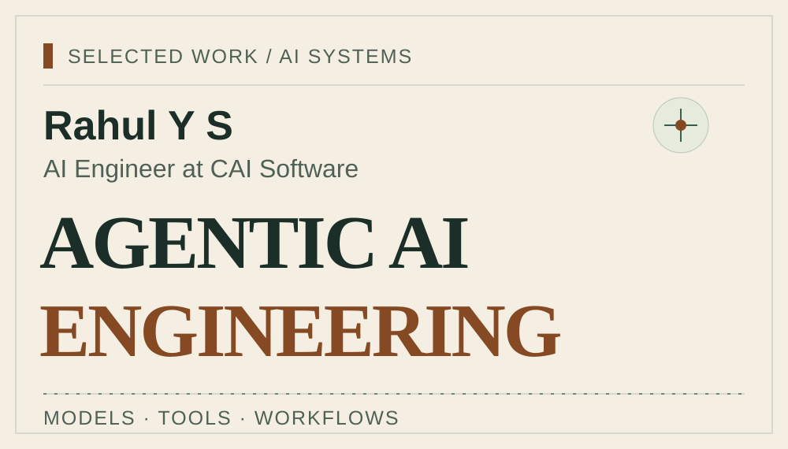
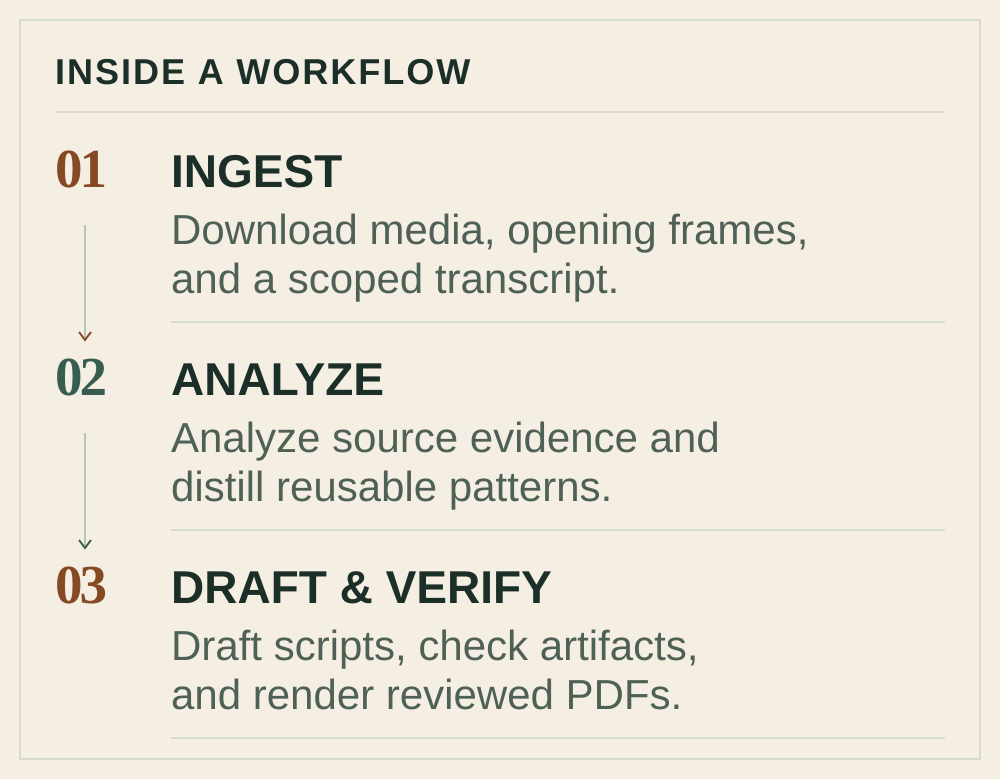

# Rahul Y S

**AI Engineer at CAI Software** · Bengaluru, India

[LinkedIn](https://www.linkedin.com/in/rahul-y-s/) · [Email](mailto:rahulreddyysr@gmail.com) · [GitHub](https://github.com/RAHULREDDYYSR) · [LeetCode](https://leetcode.com/rahul_y_s/)

<picture>
  <source media="(prefers-color-scheme: dark)" srcset="assets/hero-dark.svg">
  <source media="(prefers-color-scheme: light)" srcset="assets/hero-light.svg">
  
</picture>

**Selected projects:** [Instagram.AI](https://github.com/RAHULREDDYYSR/Instagram.AI) · [playwright-cli-demo](https://github.com/RAHULREDDYYSR/playwright-cli-demo) · [NL\_to\_SQL\_query](https://github.com/RAHULREDDYYSR/NL_to_SQL_query)

## What I'm building now

I'm an **AI Engineer at CAI Software**, developing **agentic workflows and AI Development Life Cycle (AIDLC) pipelines using Claude**.

My day-to-day focus is connecting **Claude Code, Codex, and OpenCode** with reusable **skills, Model Context Protocol (MCP) integrations, subagents, and tools**. I care about how a workflow runs: what each agent owns, how context moves between steps, where people review the result, and how outputs are checked.

I'm moving toward **forward-deployed AI engineering**: working from a real problem through the data, integrations, and implementation needed to make an AI workflow useful.

## Selected work

### 01 · [Instagram.AI](https://github.com/RAHULREDDYYSR/Instagram.AI)

**MULTI-AGENT WORKFLOWS**

A local reel-intelligence pipeline coordinated by Codex: ingest media, analyze evidence, distill patterns into a personal knowledge base, and create scripts and PDFs. Reusable skills, specialist agents, explicit role boundaries, and artifact checks guide the workflow.

### 02 · [playwright-cli-demo](https://github.com/RAHULREDDYYSR/playwright-cli-demo)

**AGENTIC TEST AUTOMATION**

A practical browser-test template: explore and plan, model page objects, generate tests, run them, and heal failures in the same fixture-backed browser context. Includes instructions for Claude Code, Copilot CLI, and OpenCode, plus a 14-scenario Demoblaze example.

### 03 · [NL\_to\_SQL\_query](https://github.com/RAHULREDDYYSR/NL_to_SQL_query)

**LANGGRAPH ORCHESTRATION**

A natural-language-to-SQL application with schema-aware validation, SQL generation, LLM-based review, and bounded feedback-driven revisions. LangGraph coordinates the workflow; Supabase/PostgreSQL provides schema context, and Streamlit the interface.

## Inside a workflow

In [Instagram.AI](https://github.com/RAHULREDDYYSR/Instagram.AI), specialist agents work through a concrete sequence:

1. **INGEST** — Download media, opening frames, and a scoped transcript.
1. **ANALYZE** — Analyze source evidence and distill reusable patterns.
1. **DRAFT & VERIFY** — Draft scripts, check artifacts, and render reviewed PDFs.

<strong>View the workflow map</strong>

<picture>
  <source media="(prefers-color-scheme: dark)" srcset="assets/closed-loop-dark.svg">
  <source media="(prefers-color-scheme: light)" srcset="assets/closed-loop-light.svg">
  
</picture>

## The foundation behind the workflows

My path has grown from **Python and NumPy → machine learning → deep learning → transformers → LLMs → RAG → agents → agentic AI**. That foundation shapes how I approach the systems around models today.

| Area | What I work with |
| --- | --- |
| Coding agents & integration | Claude Code, Codex, OpenCode, skills, MCP, subagents |
| LLM workflows | LangGraph, LangChain, structured extraction, tool use, human review |
| Retrieval & language | RAG, semantic search, Sentence Transformers, vector databases |
| Data & backend | Python, NumPy, FastAPI, PostgreSQL, Supabase, Streamlit |
| Testing & iteration | Playwright, page objects, traces, artifact validation, feedback loops |

## More experiments & applications

<strong>Retrieval &amp; grounded generation</strong>

- **[SELF-RAG](https://github.com/RAHULREDDYYSR/SELF-RAG)** — An experimental LangGraph retrieval workflow with document grading, web fallback, and checks for answer grounding and usefulness.
- **[Query-Document-s-using-RAG](https://github.com/RAHULREDDYYSR/Query-Document-s-using-RAG)** — A Streamlit PDF Q&A application exploring configurable language models, embeddings, and document retrieval.
- **[Anime\_Recommendation](https://github.com/RAHULREDDYYSR/Anime_Recommendation)** — Query refinement, Sentence Transformers embeddings, Pinecone retrieval, and structured LLM recommendations in a Streamlit app.

<strong>Applied agent systems</strong>

- **[Agent-Mailer](https://github.com/RAHULREDDYYSR/Agent-Mailer)** — Human-reviewed outreach drafting with LangGraph context-building and routing flows, GitHub context, and a FastAPI backend.
- **[Agentic-Profile-Extraction-Pipeline](https://github.com/RAHULREDDYYSR/Agentic-Profile-Extraction-Pipeline)** — Resume classification, structured extraction, deduplication, and PostgreSQL storage using LangGraph, Pydantic, PyMuPDF, and FastAPI.

<strong>Deep learning foundations</strong>

- **[SentimentAnalysis\_Using\_NN-RNN](https://github.com/RAHULREDDYYSR/SentimentAnalysis_Using_NN-RNN)** — An IMDb sentiment-analysis notebook study comparing feedforward, SimpleRNN, LSTM, and GRU models with GloVe embeddings.

<strong>Background & interests</strong>

- **Cambridge Institute of Technology** — 2021–2025.
- **Samsung PRISM virtual internship** — April 2024–January 2025. Worked on professor-profile expertise analysis using Python, Streamlit, LLMs, and NLP.
- Outside engineering, I spend time on fitness, bodybuilding, and content creation. `Instagram.AI` is where that interest meets my workflow engineering work.

Read more about my path on [LinkedIn](https://www.linkedin.com/in/rahul-y-s/).

---

**Let's connect:** [LinkedIn](https://www.linkedin.com/in/rahul-y-s/) · [Email](mailto:rahulreddyysr@gmail.com) · [GitHub](https://github.com/RAHULREDDYYSR) · [LeetCode](https://leetcode.com/rahul_y_s/)

<!-- Generated with Profile Control Plane from .profile/profile.yaml and .profile/narrative.md. Run npm run build in .profile; do not hand-edit README.md or assets/*.svg. -->
